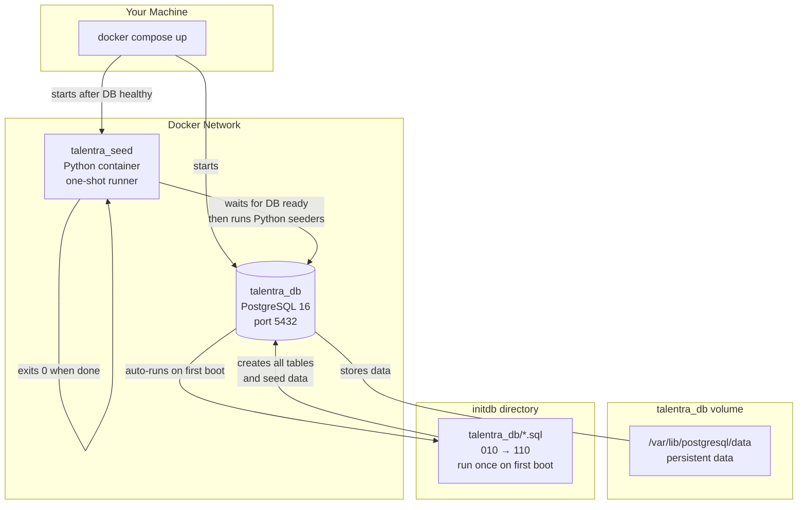
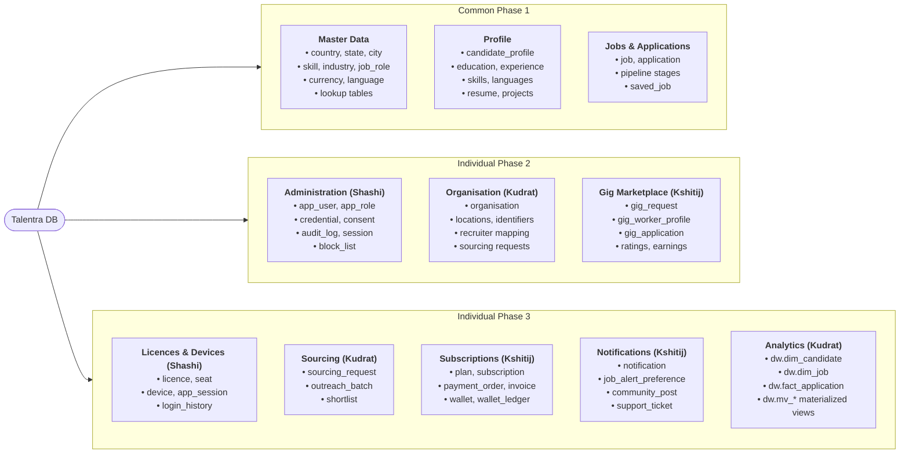
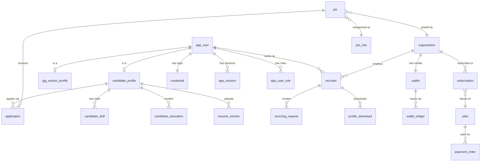
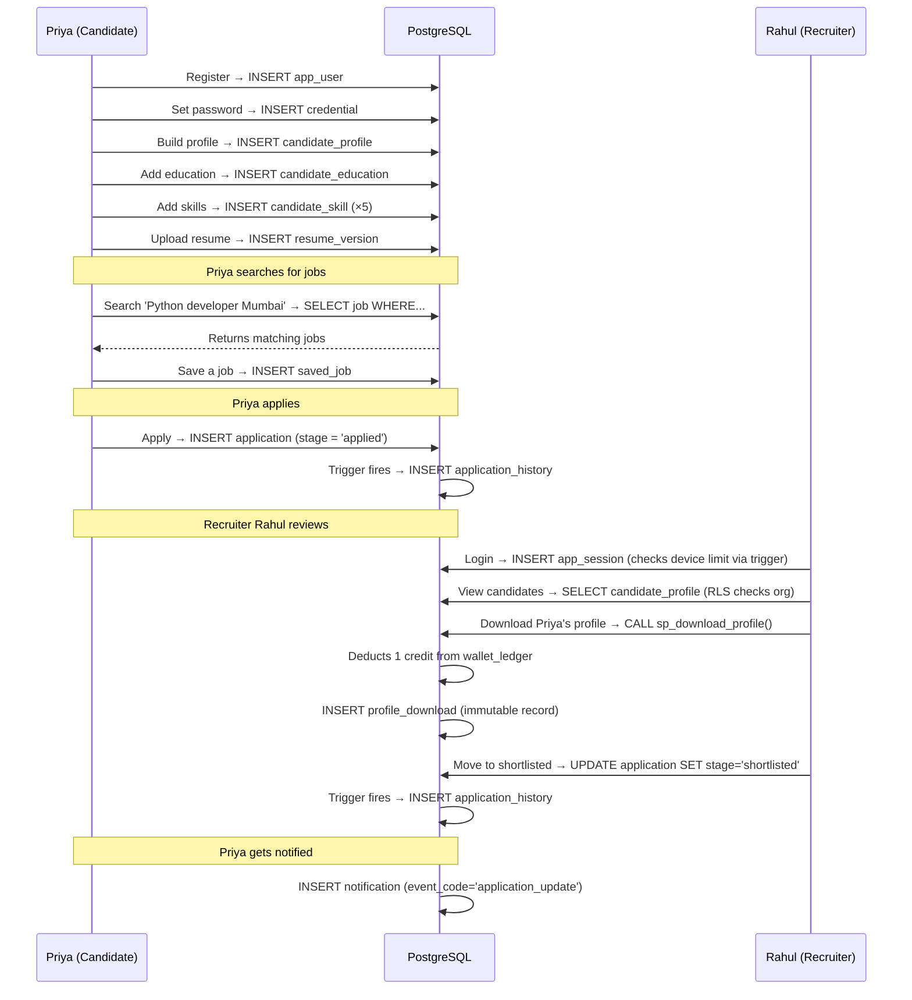
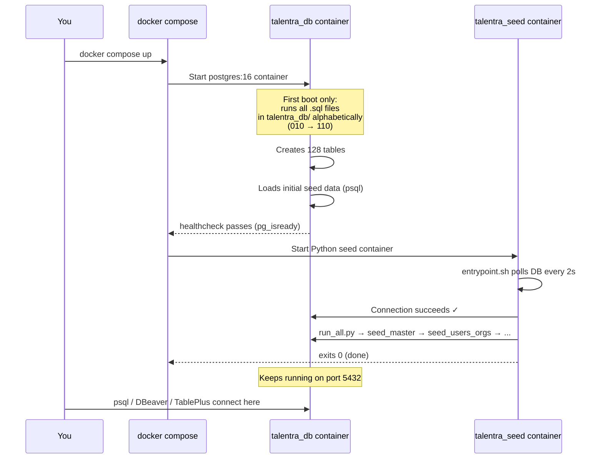
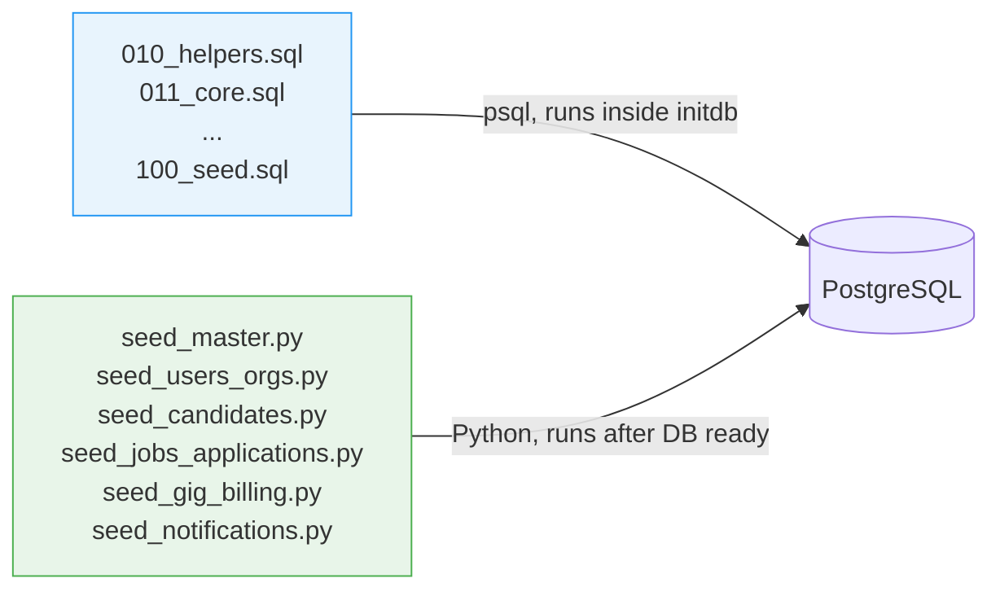
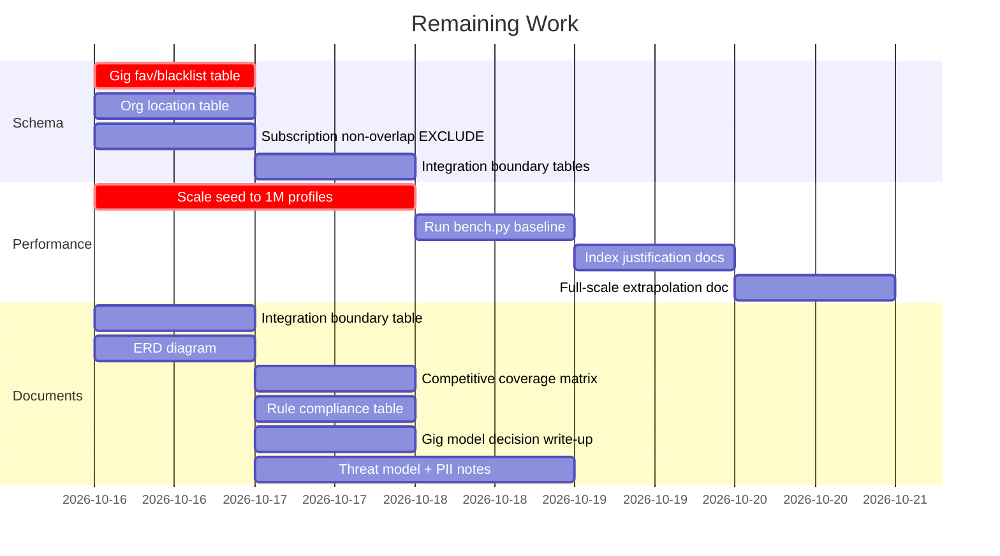

# Talentra — Project Explainer for Beginners

> Read this first if you're new to the project. No prior knowledge assumed.

---

## Table of Contents

1. [What are we building?](#1-what-are-we-building)
2. [Who uses it? (The actors)](#2-who-uses-it-the-actors)
3. [What is a "database design hackathon"?](#3-what-is-a-database-design-hackathon)
4. [How to think about entities](#4-how-to-think-about-entities)
5. [The big picture — system architecture](#5-the-big-picture--system-architecture)
6. [The 11 modules — what does each one own?](#6-the-11-modules--what-does-each-one-own)
7. [How the modules connect to each other](#7-how-the-modules-connect-to-each-other)
8. [Walk through a real user journey](#8-walk-through-a-real-user-journey)
9. [The codebase — what every file does](#9-the-codebase--what-every-file-does)
10. [How Docker makes it all run](#10-how-docker-makes-it-all-run)
11. [The seed data — why it exists and what it does](#11-the-seed-data--why-it-exists-and-what-it-does)
12. [What has been built so far](#12-what-has-been-built-so-far)
13. [What is still pending](#13-what-is-still-pending)
14. [Glossary](#14-glossary)

---

## 1. What are we building?

Imagine **LinkedIn + Naukri + Uber (for short-term work)** — all rolled into one database.

**Talentra** is a job search and demand management platform. It connects:
- People looking for jobs (candidates)
- Companies posting jobs (employers / organisations)
- Recruiters who source talent on behalf of companies
- Freelancers taking short gigs (gig workers)

The goal of this hackathon is **not** to build the website or mobile app.
The goal is to design and build the **database** that would power such a platform —
and prove it works correctly, performs well, and is secure.

Think of the database as the foundation of a building. The app (UI) sits on top.
We are only building the foundation.

```
┌─────────────────────────────────────────┐
│         Mobile App / Web App            │  ← NOT our job
├─────────────────────────────────────────┤
│         API / Backend Service           │  ← NOT our job
├─────────────────────────────────────────┤
│   ✅  PostgreSQL Database (Talentra)    │  ← THIS is what we build
└─────────────────────────────────────────┘
```

---

## 2. Who uses it? (The actors)

| Actor | What they do |
|---|---|
| **Candidate** | Creates a profile, uploads a resume, searches and applies for jobs |
| **Employer** | Registers a company, posts job requirements, reviews applications |
| **Recruiter** | Works inside a company, sources candidates, manages the hiring pipeline |
| **Consultant** | A freelance recruiter; sources candidates for jobs that are "open to consultants" |
| **Gig Worker** | Takes short-term project work (events, delivery, data entry, etc.) |
| **Admin** | Manages the platform — users, permissions, billing |
| **TPO** (Placement Officer) | Campus/college placement coordinator |
| **Guest** | Browsing without an account |

---

## 3. What is a "database design hackathon"?

A normal hackathon asks you to build an app in 2 days.
This one asks you to **design a production-grade database** in 2 days.

The judges will ask questions like:
- "Why did you pick this data type for salary?"
- "How do you stop two sessions from exceeding the device limit simultaneously?"
- "Show me the query plan for searching 1 million candidates by skill and city."

You need to have **working SQL**, **seed data** (fake but realistic data), **performance numbers**,
and **written justifications** for your design decisions.

---

## 4. How to think about entities

An **entity** is just a "thing" the database needs to remember.

**Step 1 — Read the requirement and spot the nouns.**

> "A candidate creates a profile, uploads a resume, and applies for jobs posted by employers."

Nouns → `candidate`, `profile`, `resume`, `job`, `employer`
Each noun is likely a table.

**Step 2 — Find the relationships (verbs).**

> "A candidate **applies for** a job"

Verb → `application` table, linking `candidate_profile` → `job`

**Step 3 — Find the attributes (adjectives / details).**

> "A job has a title, a salary range, a location, and a deadline."

Attributes → columns inside the `job` table.

**Step 4 — Spot the rules (constraints).**

> "An end date cannot be earlier than a start date."

Rule → `CHECK (end_date >= start_date)` constraint in SQL.

That's the entire process. You repeat it for every sentence in the requirements document.

---

## 5. The big picture — system architecture

Here is how all the pieces fit together when you run `docker compose up`:



**In plain English:**
1. You run `docker compose up`
2. The **DB container** starts, creates the `talentra` database, then runs all the `.sql` files in order (010 → 110). This creates all 128 tables and loads basic seed data.
3. The **seed container** (Python) waits until the DB is ready, then runs 6 Python scripts that insert realistic fake data (candidates, jobs, applications, etc.)
4. The seed container exits. The DB container keeps running.
5. You connect to `localhost:5432` with any Postgres client.

---

## 6. The 11 modules — what does each one own?

The project is split into 11 modules. Think of each module as a "department" that owns certain tables.



---

## 7. How the modules connect to each other

Every module shares the `app_user` table — it is the single identity record for every person on the platform. Everything hangs off it.



---

## 8. Walk through a real user journey

Let's follow **Priya** as she finds a job, so you can see which tables get touched:



**Key insight:** A single "apply for a job" action touches 3+ tables and fires 2 triggers automatically. The database enforces the business rules — the app doesn't need to.

---

## 9. The codebase — what every file does

```
talentra/
│
├── docker-compose.yml          ← Defines 2 containers: db + seed
│
├── talentra_db/                ← SQL files. Docker auto-runs these on first boot.
│   ├── 010_helpers.sql         ← Helper procedures: sp_add_audit, sp_make_append_only,
│   │                              sp_index_fks, sp_create_lookup
│   ├── 011_core.sql            ← Foundation: app_user, master data tables,
│   │                              stub organisation/candidate_profile/job
│   ├── 020_admin_licence.sql   ← Roles, permissions, credentials, sessions,
│   │                              licences, seats, devices, audit_log
│   ├── 030_org_sourcing.sql    ← Organisation details, recruiters,
│   │                              sourcing requests, outreach batches, shortlists
│   ├── 040_candidate.sql       ← Education, experience, skills, resume,
│   │                              projects, assessments, block_list
│   ├── 041_candidate_missing.sql ← Extra candidate tables: course_enrolment,
│   │                              profile_view_history, referral_tracking,
│   │                              resume_template, shortlist_bookmark_history
│   ├── 050_jobs_applications.sql ← Job skills/questions/positions,
│   │                              applications, answers, history trigger, saved_job
│   ├── 051_jobs_applications_missing.sql ← Job categories, job_search_history,
│   │                              extended block_list (recruiter/consultant blocking)
│   ├── 060_gig_finance.sql     ← Gig marketplace (requests, workers, applications,
│   │                              assignments), subscriptions, payments, wallet
│   ├── 070_notifications_community.sql ← Notifications (partitioned by month),
│   │                              community posts, support tickets, FAQs
│   ├── 080_analytics.sql       ← Data warehouse: dw schema, SCD2 dimensions,
│   │                              fact tables, materialised views
│   ├── 090_security_rls.sql    ← DB roles (app_candidate, app_recruiter, app_admin)
│   │                              and Row-Level Security policies
│   ├── 095_index_fks.sql       ← Calls sp_index_fks() to index all FK columns
│   ├── 100_seed.sql            ← psql-based seed (200 orgs, 10K profiles, 2K jobs,
│   │                              50K applications) — runs via initdb
│   ├── 110_compliance_checks.sql ← SELECT queries that return 0 rows if all
│   │                              design rules are met
│   │
│   ├── manual_120_tests.sql.manual  ← Constraint tests (run manually via psql)
│   ├── manual_130_benchmark.sql.manual ← 12 benchmark queries (run manually)
│   └── manual_140_data_dictionary.sql.manual ← Data dictionary view
│
├── seed/                       ← Python seed container
│   ├── Dockerfile              ← Builds the Python seed image
│   ├── entrypoint.sh           ← Waits for DB (150 attempts × 2s), then runs seeders
│   ├── requirements.txt        ← psycopg, faker
│   ├── config.py               ← DB connection + scale constants (N_CANDIDATES, etc.)
│   ├── run_all.py              ← Orchestrator: runs all seeders in order
│   ├── seed_master.py          ← Inserts currencies, languages, countries, skills, etc.
│   ├── seed_users_orgs.py      ← Inserts roles, organisations, recruiter users
│   ├── seed_candidates.py      ← Inserts candidate users, profiles, skills, education
│   ├── seed_jobs_applications.py ← Inserts jobs, applications, history, saved_jobs
│   ├── seed_gig_billing.py     ← Inserts gig data, plans, subscriptions, wallets
│   └── seed_notifications.py   ← Inserts notifications, FAQs, community posts
│
├── docs/                       ← Design documentation
│   ├── 00_project_explainer.md ← This file ← You are here
│   ├── 01_B1_db_provider_decision.md ← Why PostgreSQL over MySQL
│   ├── 02_B2_B3_modules_and_assignments.md ← Module ownership
│   ├── 03_project_conventions.md ← Naming rules, data types, patterns
│   ├── 04_task_board.md        ← Day 1 task assignments
│   ├── 05_master_data_sources.md ← Where reference data comes from
│   └── decision_log.md         ← Log of key design decisions
│
├── run_all.sh                  ← Manual script to re-run all SQL files
├── backup_restore_test.sh      ← Tests pg_dump → pg_restore + verifies row counts
└── bench.py                    ← Runs 12 benchmark queries and records p50/p95/p99
```

---

## 10. How Docker makes it all run

You only need one command:

```bash
docker compose up
```

Here is what happens step by step:



**Important:** The SQL files in `talentra_db/` only run **once** — on the very first boot when the volume is empty. If you want to reset everything and start fresh:

```bash
docker compose down -v   # -v removes the data volume
docker compose up        # starts clean
```

---

## 11. The seed data — why it exists and what it does

The database tables are just empty buckets when first created. **Seed data** fills them with realistic fake data so you can:
- Test queries ("show me all Python developers in Mumbai")
- Measure performance ("how fast is this search with 10,000 profiles?")
- Demonstrate the system works ("here are 50,000 applications across 6 pipeline stages")

### Two layers of seeding



**Layer 1 — SQL seed (`100_seed.sql`)**: Fast bulk insert using pure SQL `generate_series()`. Creates the base dataset that the schema needs to be functional.

**Layer 2 — Python seed (`seed/`)**: More realistic data using the Faker library (real-sounding names, Indian cities, company names). Idempotent — safe to re-run.

### Current seed scale (small/dev mode)

| Table | Rows |
|---|---|
| candidate_profile | 10,500 |
| job | 2,100 |
| application | 51,000 |
| notification | 50,200 |
| organisation | 220 |
| app_user | 10,722 |
| gig_request | 50 |
| wallet_ledger | 440 |
| **dw.fact_application** | 50,000 |

The docket requires **1 million profiles** for performance testing. To scale up, change `config.py`:
```python
N_CANDIDATES = 1_000_000   # was 500
N_ORGS       = 10_000      # was 20
N_JOBS       = 100_000     # was 100
APPS_PER_JOB = 50          # was 10
```

---

## 12. What has been built so far

### ✅ The schema (128 tables, 0 rule violations)

All 11 modules have tables in the database. Here's a summary:

```mermaid
flowchart TB
  subgraph master["Master Data ✅"]
    direction TB
    md1["country / state / city"]
    md2["skill / industry / job_role"]
    md3["currency / language"]
    md4["lookup_translation"]
  end

  subgraph profile["Candidate Profile ✅"]
    direction TB
    p1["candidate_profile"]
    p2["education / experience"]
    p3["skills / languages"]
    p4["resume / projects / courses"]
  end

  subgraph jobs["Jobs & Applications ✅"]
    direction TB
    j1["job / job_skill"]
    j2["application (partitioned-ready)"]
    j3["application_history (append-only)"]
    j4["saved_job / job_search_history"]
  end

  subgraph admin["Administration ✅"]
    direction TB
    a1["app_user / app_role"]
    a2["credential / consent_record"]
    a3["app_session / device"]
    a4["audit_log (append-only)"]
  end

  subgraph org["Organisation ✅"]
    direction TB
    o1["organisation (hierarchy)"]
    o2["organisation_identifier"]
    o3["recruiter / sourcing_request"]
    o4["outreach_batch / shortlist"]
  end

  subgraph gig["Gig Marketplace ✅"]
    direction TB
    g1["gig_request (non-overlap windows)"]
    g2["gig_worker_profile"]
    g3["gig_application / assignment"]
    g4["gig_rating / gig_earning_reference"]
  end

  subgraph lic["Licences & Sessions ✅"]
    direction TB
    l1["licence / seat"]
    l2["device (revocable)"]
    l3["app_session (concurrent limit)"]
    l4["login_history (append-only)"]
  end

  subgraph billing["Subscriptions & Wallet ✅"]
    direction TB
    b1["plan / subscription"]
    b2["payment_order / invoice / refund"]
    b3["wallet / wallet_ledger (append-only)"]
    b4["profile_download (credit deducted)"]
  end

  subgraph notif["Notifications ✅"]
    direction TB
    n1["notification (monthly partitions)"]
    n2["job_alert_preference"]
    n3["community_post / comment"]
    n4["support_ticket / faq"]
  end

  subgraph analytics["Analytics (dw schema) ✅"]
    direction TB
    an1["dw.dim_date / dim_candidate"]
    an2["dw.dim_job / dim_organisation"]
    an3["dw.fact_application / fact_payment"]
    an4["dw.mv_* materialised views"]
  end

  subgraph security["Security (RLS) ✅"]
    direction TB
    s1["app_candidate role"]
    s2["app_recruiter role"]
    s3["app_admin role"]
    s4["RLS on 4 tables"]
  end
```



### ✅ Key database rules enforced automatically

| Rule | How it's enforced |
|---|---|
| Wallet can't go negative | `CHECK (balance_credits >= 0)` on `wallet` |
| Wallet ledger is immutable | `BEFORE UPDATE/DELETE` trigger raises exception |
| Seat limit can't be exceeded | `BEFORE INSERT` trigger on `seat` checks count |
| Session limit enforced at login | `BEFORE INSERT` trigger on `app_session` |
| Gig windows can't overlap for same worker | `EXCLUDE USING GIST` constraint |
| Subscription periods can't overlap | To be added — currently missing |
| Recruiter only sees their company's jobs | Row-Level Security policy |
| Candidate can't be seen by someone they blocked | RLS policy checks `block_list` |
| Append-only tables (audit, ledger, history) | Trigger blocks UPDATE, DELETE, TRUNCATE |
| Profile download deducts exactly 1 credit | `sp_download_profile()` stored function with idempotency key |

---

## 13. What is still pending



**Top 3 things to do next:**
1. Scale up seed data to laptop-scale (1M profiles) — everything else depends on real numbers
2. Run `bench.py` and write the performance baseline report
3. Write the integration boundary table (Section 6 of the docket) — it's reviewed at the panel

---

## 14. Glossary

| Term | Plain English |
|---|---|
| **Entity** | A "thing" the database tracks — usually becomes a table |
| **Attribute** | A property of an entity — becomes a column |
| **Primary Key (PK)** | A unique ID for every row. We use `bigint GENERATED ALWAYS AS IDENTITY` — the DB assigns IDs automatically |
| **Foreign Key (FK)** | A column that references another table's PK. Enforces relationships. |
| **Constraint** | A rule the DB enforces automatically (CHECK, UNIQUE, NOT NULL, FOREIGN KEY) |
| **Trigger** | A function that runs automatically when you INSERT/UPDATE/DELETE |
| **RLS (Row-Level Security)** | A PostgreSQL feature that hides certain rows from certain users automatically |
| **Append-only table** | A table where rows can only be inserted, never changed or deleted (audit logs, ledgers) |
| **Seed data** | Fake but realistic data used for testing and demos |
| **Idempotency key** | A unique token that prevents the same operation from running twice (e.g., charging a card twice) |
| **Star schema** | A data warehouse pattern: one fact table (numbers) surrounded by dimension tables (context) |
| **Materialised view** | A query result saved as a physical table — fast to read, needs to be refreshed periodically |
| **GIST / EXCLUDE** | A PostgreSQL feature to prevent overlapping ranges (e.g., two gig windows for the same worker) |
| **SCD2** | Slowly Changing Dimension Type 2 — a way to track history of changes in dimension tables |
| **p50 / p95 / p99** | Percentile latencies. p95 = 95% of queries finished in this time or faster |
| **initdb** | The PostgreSQL startup process that runs SQL files on first boot |
| **psycopg** | The Python library used to connect to and query PostgreSQL |

---

*Last updated: October 2026 | Branch: feature/kt-seeding*
